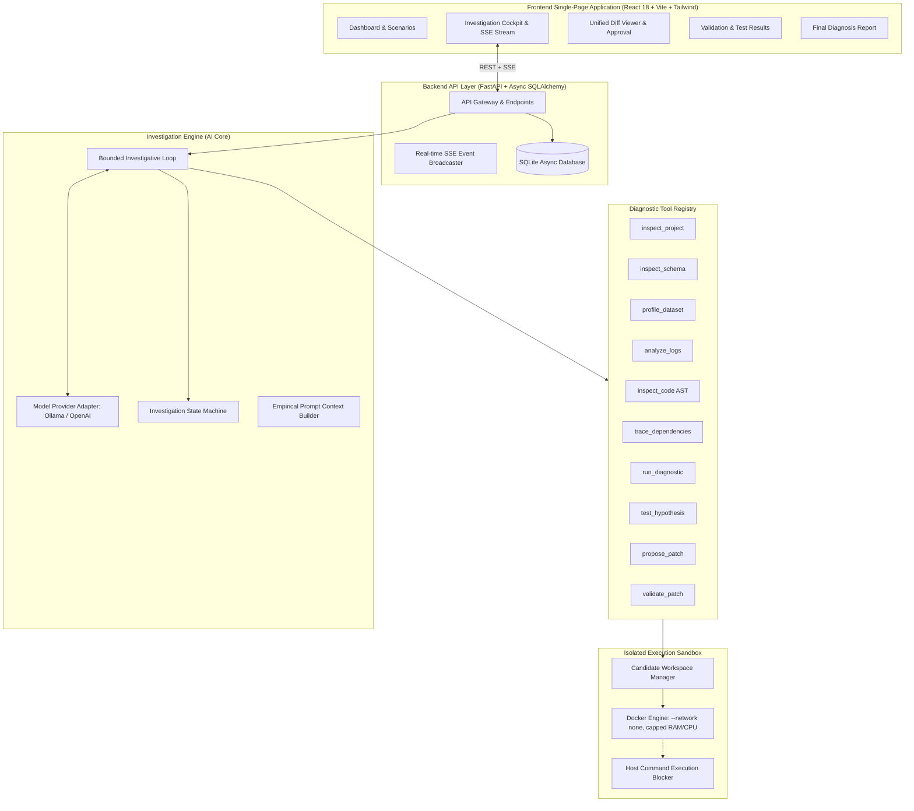

# PipelineSleuth: Comprehensive System Documentation & Engineering Dossier

**Product Name:** PipelineSleuth  
**Tagline:** *Don't just detect pipeline failures. Investigate them.*  
**Product Category:** AI-Powered Developer Infrastructure / Autonomous Data Engineering Intelligence  
**Repository:** [github.com/benjamin-nweke/pipelinesleuth](https://github.com/benjamin-nweke/pipelinesleuth)  
**Version:** 1.0.0 (Production-Ready Local Implementation)  
**Date:** November 2026  

---

## Table of Contents
1. [Executive Summary & Product Mission](#1-executive-summary--product-mission)
2. [Core Product & Engineering Principles](#2-core-product--engineering-principles)
3. [End-to-End System Architecture](#3-end-to-end-system-architecture)
4. [Backend API & Data Persistence](#4-backend-api--data-persistence)
5. [The Autonomous AI Investigation Engine](#5-the-autonomous-ai-investigation-engine)
6. [Diagnostic Tool Registry (All 10 Tools)](#6-diagnostic-tool-registry-all-10-tools)
7. [Execution Sandbox & Security Infrastructure](#7-execution-sandbox--security-infrastructure)
8. [Frontend Single-Page Application (8 Pages)](#8-frontend-single-page-application-8-pages)
9. [The Three Demonstration Scenarios](#9-the-three-demonstration-scenarios)
10. [Testing Suite & Engineering Verification](#10-testing-suite--engineering-verification)
11. [Setup, Deployment & Developer Guide](#11-setup-deployment--developer-guide)
12. [Git Repository & Version Control Status](#12-git-repository--version-control-status)

---

## 1. Executive Summary & Product Mission

Modern data pipelines fail constantly due to silent upstream changes: schema shifts, dirty string values in numeric columns, unexpected nulls in financial ledgers, and corrupted partitions. Traditional orchestrators (Airflow, Dagster, Prefect) only alert developers to a failure (`Task Failed with Exit Code 1`), forcing data engineers to spend hours combing through megabytes of raw logs, querying upstream warehouses, reproducing errors locally, writing hotfixes, and crossing fingers that fixes don't introduce regressions.

**PipelineSleuth** transforms this experience. It acts as an autonomous AI investigation agent that:
1. **Ingests** broken pipeline projects, logs, schemas, and datasets.
2. **Orchestrates** an empirical, multi-turn investigative loop using an isolated diagnostic tool registry.
3. **Formulates, tests, and revises** hypotheses backed by traceable evidence.
4. **Synthesizes** minimal code corrections as unified diffs.
5. **Enforces human control:** requires explicit human approval before touching code.
6. **Validates corrections** in an isolated Docker container sandbox (`--network none`) against a separate candidate workspace copy.
7. **Produces** an executive, evidence-backed root cause report with regression analysis.

---

## 2. Core Product & Engineering Principles

| Principle | Meaning & Enforcement in PipelineSleuth |
|---|---|
| **AI as Principal Engine** | The LLM is the core reasoning brain. It decides which tools to call, interprets tool outputs, revises hypotheses, and formulates patches. There is no fake log viewer or hardcoded decision tree. |
| **No Simulated Intelligence** | Every visible event, hypothesis, evidence record, and patch stems from real model inferences and real diagnostic tool executions. If the AI model or Docker is offline, the application honestly reports the outage. |
| **Evidence Before Conclusions** | Diagnoses require traceable evidence IDs linking to concrete file paths, line numbers, column names, AST structures, or log timestamps. |
| **Human Control (Governance)** | The agent **never modifies original project files**. Proposed patches require explicit human review and approval. Validation executes only against separate temporary candidate workspaces. |
| **Zero Silent Corruption** | Fixes for data-quality or type-mismatch bugs must not naively `.dropna()` or `.fillna(0.0)` in financial pipelines without clear justification, preserving accounting integrity. |
| **Strict Security Boundaries** | Docker containers run with `--network none`, memory/CPU caps, non-root user, and restricted mounts. If Docker is missing, **arbitrary host execution is blocked**. |

---

## 3. End-to-End System Architecture

PipelineSleuth is partitioned into five distinct, decoupled subsystems:



---

## 4. Backend API & Data Persistence

### 4.1 Persistence Layer
PipelineSleuth uses an asynchronous SQLAlchemy engine backed by SQLite (`sqlite+aiosqlite:///./data/pipelinesleuth.db`), supporting fast local execution and atomic state transitions.

#### Relational Entities:
1. `projects` & `project_files`: Project metadata, filesystem references, and file content tracking.
2. `investigations`: Investigation state, current stage, confidence score, remaining tool budget, and final report linkage.
3. `investigation_events`: Audit log of all timeline events (`thought`, `tool_call`, `tool_result`, `hypothesis_update`, `evidence_found`, `patch_proposed`, etc.).
4. `evidence_records`: Traceable evidence units (`evidence_type`, `source_file`, `line_number`, `column_name`, `observation`).
5. `hypotheses`: Formulated theories (`title`, `description`, `status`, `confidence`, `reasoning`).
6. `tool_executions`: Full telemetry of every diagnostic tool run (`tool_name`, `input_arguments`, `output_result`, `error_message`, `execution_time_ms`).
7. `patch_proposals`: Candidate code fixes (`target_file`, `unified_diff`, `explanation`, `status: pending_approval | approved | rejected`).
8. `validation_runs`: Empirical test outcomes (`exit_code`, `test_summary`, `stdout`, `stderr`, `status: passed | failed | skipped`).
9. `investigation_reports`: Executive Markdown reports (`root_cause`, `affected_components`, `remediation_summary`, `remaining_risks`).
10. `app_settings`: Global configuration (`llm_provider`, `model_name`, `ollama_endpoint`, `openai_api_key`, `sandbox_timeout`).

### 4.2 REST & Real-time Endpoints

| Method | Endpoint | Description |
|---|---|---|
| `GET` | `/api/dashboard/stats` | Aggregated metrics (active, completed, hypotheses, patches, success rate). |
| `POST` | `/api/projects` | Upload project files as multipart/form-data. |
| `GET` | `/api/projects` | List all tracked projects. |
| `POST` | `/api/investigations` | Launch an autonomous investigation session for a project. |
| `GET` | `/api/investigations/{id}` | Retrieve investigation state, stage, and confidence. |
| `GET` | `/api/investigations/{id}/events` | Real-time Server-Sent Events (SSE) streaming live investigation progress. |
| `GET` | `/api/investigations/{id}/evidence` | List all evidence records logged for an investigation. |
| `GET` | `/api/investigations/{id}/hypotheses` | List all hypotheses and their evolution. |
| `GET` | `/api/investigations/{id}/patches` | Retrieve patch proposals and unified diffs. |
| `POST` | `/api/investigations/{id}/patches/{pid}/action` | Approve or reject a candidate patch. |
| `GET` | `/api/investigations/{id}/validation` | Retrieve isolated validation runs, stdout/stderr, and exit codes. |
| `GET` | `/api/investigations/{id}/report` | Retrieve the generated final diagnosis report. |
| `GET` | `/api/demos` | List built-in pipeline failure scenarios. |
| `POST` | `/api/demos/{key}/load` | One-click deployment of a demonstration scenario project. |
| `GET` / `PUT` | `/api/settings` | Read or update AI model configuration and sandbox limits. |

---

## 5. The Autonomous AI Investigation Engine

### 5.1 Architecture & Model Provider Abstraction
The AI engine (`backend/app/agents/`) decouples investigative logic from LLM APIs through the `IModelProvider` interface:
- **`OllamaModelProvider`**: Local GPU/CPU inference against Ollama (`qwen2.5-coder:7b`, `llama3.2`, `mistral`).
- **`OpenAIModelProvider`**: OpenAI-compatible REST endpoints (`gpt-4o`, `deepseek-chat`, etc.).
- **Graceful Failure**: If the model is offline or returns invalid JSON, the engine captures the failure, emits an `AI Model Unavailable` event, and halts cleanly.

### 5.2 Structured Decision Schema (`AgentDecision`)
Every model decision must conform to the strict Pydantic contract:
```json
{
  "thinking": "Detailed chain of thought interpreting recent tool outputs and evidence gaps",
  "current_stage": "context_collection | failure_localization | hypothesis_generation | evidence_collection | patch_generation | report_generation",
  "hypotheses": [
    {
      "id": "optional existing ID e.g. HYP-01",
      "title": "Concise failure hypothesis",
      "description": "Mechanism of failure",
      "status": "formulated | testing | confirmed | rejected | inconclusive",
      "confidence": 0.0 to 1.0,
      "reasoning": "Justification based on collected evidence"
    }
  ],
  "new_evidence": [
    {
      "source_file": "path/to/file",
      "evidence_type": "schema_diff | dataset_anomaly | log_stacktrace | ast_pattern",
      "line_number": 42,
      "column_name": "amount",
      "observation": "Factual finding from tool output",
      "associated_hypothesis_id": "HYP-01"
    }
  ],
  "action_type": "call_tool | propose_patch | conclude_success | conclude_inconclusive",
  "tool_call": {
    "tool_name": "profile_dataset",
    "arguments": { "dataset_path": "data/transactions.csv" }
  },
  "patch_proposal": { ... },
  "final_report": { ... }
}
```

### 5.3 Bounded Loop & Feedback Mechanisms
1. **Tool Budget Limit:** `max_tool_calls` (default 12) prevents runaway execution.
2. **Duplicate Prevention Guard:** Detects identical consecutive tool calls (`tool_name` + identical arguments). If repeated, forces hypothesis synthesis to break infinite loops.
3. **Empirical Feedback Injection:** Results from the last 6 `ToolExecution` entries are summarized and passed into `Recent Diagnostic Tool Outputs` within the prompt for turn $N+1$, ensuring the model reasons over actual empirical findings.

---

## 6. Diagnostic Tool Registry (All 10 Tools)

The agent cannot execute arbitrary bash commands. It can only call tools registered in `backend/app/tools/registry.py`:

| Tool Name | Permission | Purpose & Technical Implementation |
|---|---|---|
| `inspect_project` | `read_only` | Recursively inspects project root, cataloging Python scripts, CSV/Parquet data, log files, and dependencies with file sizes. |
| `inspect_schema` | `read_only` | Uses `pandas` and `pyarrow` to read datasets, schemas, and compares against baseline/upstream schemas to detect column additions, deletions, renames, and type drifts. |
| `profile_dataset` | `read_only` | Computes column-level metrics: null counts, distinct counts, data types, statistical quantiles, and scans for mixed-type tokens (e.g. `'pending'`, `'N/A'`). |
| `analyze_logs` | `read_only` | Scans log files and tracebacks. Extracts error classes, line numbers, failing code frames, and pipeline stages. **Includes automated credential scrubber** redacting Bearer tokens, AWS keys, and passwords. |
| `inspect_code` | `read_only` | Uses Python's native `ast` module to statically inspect code. Extracts functions, imports, referenced DataFrame columns, and localized syntax nodes around the error line. |
| `trace_dependencies` | `read_only` | Parses imports, data sources, and target outputs to build a directed graph of pipeline stages. |
| `run_diagnostic` | `sandboxed_exec` | Executes bounded, read-only diagnostic Python commands inside the restricted container. |
| `test_hypothesis` | `read_only` | Formally evaluates whether supporting and contradicting evidence confirms or refutes a candidate hypothesis. |
| `propose_patch` | `read_only` | Validates replacement code syntax using `ast.parse()`, extracts surrounding context, and produces a standard unified diff (`difflib.unified_diff`). |
| `validate_patch` | `sandboxed_exec` | Clones project into an isolated candidate workspace copy, applies the patch, and executes `pytest` inside the Docker sandbox. Captures exit code, test summary, stdout, and stderr. |

---

## 7. Execution Sandbox & Security Infrastructure

### 7.1 Sandbox Isolation Architecture
The execution sandbox (`backend/app/sandbox/manager.py`) guarantees that untrusted user code or candidate fixes never jeopardize host system integrity:

```
[Candidate Workspace: /tmp/pipelinesleuth/workspaces/cand_val_XYZ]
                     │ (bind mounted read-write)
                     ▼
  ┌─────────────────────────────────────────────────────────┐
  │                 Docker Container Sandbox                │
  │  - User: non-root (pipelinesleuth:pipelinesleuth)       │
  │  - Network: --network none (Strict network isolation)   │
  │  - Memory: --memory 1g (Hard memory ceiling)            │
  │  - CPU: --cpus 1.0 (CPU core throttling)                │
  │  - Storage: Read-write only to mounted /workspace       │
  │  - Working Directory: /workspace                        │
  │  - Privileges: Non-privileged (no host devices/caps)    │
  └─────────────────────────────────────────────────────────┘
```

### 7.2 Strict Fallback Guard
If Docker is not installed or the Docker daemon is offline, **PipelineSleuth refuses to run uncontained commands on the host machine**. It returns an explicit security block:
```
EXECUTION BLOCKED BY SECURITY POLICY:
Docker is required for isolated container execution, but is unavailable: Docker is not installed or not in PATH.
PipelineSleuth does not allow uncontained, arbitrary Python host execution for safety.
Please install Docker Desktop and start the Docker daemon to enable pipeline execution.
```

### 7.3 Path Traversal & Archive Safety
All filesystem operations resolve paths against `base_dir` and enforce:
```python
if not str(resolved_path).startswith(str(base_dir)):
    raise SecurityException("Path traversal attempted.")
```

---

## 8. Frontend Single-Page Application (8 Pages)

Built with **React 18, TypeScript, Vite, Tailwind CSS, Lucide React, and TanStack React Query**.

| Page | Route | Features & Capabilities |
|---|---|---|
| **Dashboard** | `/` | Real-time telemetry: Active investigations, resolved incidents, hypothesis counts, sandbox pass rates. One-click demo scenario launchers. |
| **New Investigation** | `/new` | Drag-and-drop project uploader, pipeline objective specification, model selection override. |
| **Workspace (Cockpit)** | `/investigations/:id` | Real-time multi-panel investigation dashboard. Left: Project file tree & stage badge. Center: Live Server-Sent Events (SSE) timeline with agent thoughts, tool calls, and results. Right: Live hypothesis tracker with confidence bars. |
| **Evidence Explorer** | `/investigations/:id/evidence` | Categorized evidence cards showing source files, line numbers, column names, raw observations, and links to verified hypotheses. |
| **Patch Review** | `/investigations/:id/patch` | Syntax-highlighted unified diff viewer (`+` green, `-` red), risk assessment callout, and one-click **Approve Patch** or **Reject Patch** buttons. |
| **Validation Results** | `/investigations/:id/validation` | Isolated container execution output: Process exit code, test pass/fail counts, duration, and terminal-style stdout/stderr viewer. |
| **Final Report** | `/investigations/:id/report` | Executive diagnosis report: Root cause analysis, affected components, remediation diff, remaining risks, and Markdown/HTML print export. |
| **Settings** | `/settings` | LLM provider toggle (Ollama / OpenAI), API endpoint configuration, timeout adjustments, and sandbox memory limit controls. |

---

## 9. The Three Demonstration Scenarios

Three pre-built, realistic data engineering failure scenarios are included in `demo/`:

### 9.1 Scenario A: Schema Drift (`demo/schema_drift`)
- **The Problem:** An upstream payment service changed its schema, renaming `customer_id` to `client_id`.
- **Pipeline Failure:** Downstream aggregation throws `KeyError: "Required column 'customer_id' missing from transaction dataset!"`.
- **Agent Investigation:**
  1. `analyze_logs`: Extracts `KeyError` at `pipeline.py:21`.
  2. `inspect_schema`: Detects `customer_id` missing from current data, discovers `client_id`.
  3. `inspect_code`: AST analysis confirms `df.groupby("customer_id")` requires the field.
  4. `test_hypothesis`: Confirms hypothesis `"Upstream Schema Drift: customer_id renamed to client_id"`.
  5. `propose_patch`: Adds backward-compatible column aliasing:
     ```python
     if "client_id" in df.columns and "customer_id" not in df.columns:
         df = df.rename(columns={"client_id": "customer_id"})
     ```
  6. **Validation:** Runs `pytest` in Docker sandbox; pipeline completes with exit code 0.

### 9.2 Scenario B: Data Quality (`demo/data_quality`)
- **The Problem:** Ingested ledger contains null/missing values in critical financial field `amount`.
- **Pipeline Failure:** Ledger reconciliation halts with `ValueError: Found 2 NULL values in critical financial field 'amount'`.
- **Agent Investigation:**
  1. `analyze_logs`: Pinpoints data quality exception.
  2. `profile_dataset`: Computes 22.2% null rate in `amount`.
  3. **Data Integrity Guard:** Agent explicitly avoids silent corruption (`.dropna()` or `.fillna(0.0)`) and proposes a partitioned ledger quarantine for unreconciled transactions.
  4. **Validation:** Ledger reconciles cleanly with audit trail.

### 9.3 Scenario C: Type Mismatch (`demo/type_mismatch`)
- **The Problem:** Ingested CSV contains non-numeric dirty strings (`"pending"`, `"N/A"`) inside `amount`.
- **Pipeline Failure:** Pandas float conversion throws `ValueError: could not convert string to float: 'pending'`.
- **Agent Investigation:**
  1. `analyze_logs`: Identifies `ValueError` during `astype(float)`.
  2. `profile_dataset`: Scans string tokens, isolating `'pending'` and `'N/A'`.
  3. `propose_patch`: Uses `pd.to_numeric(df['amount'], errors='coerce')` with explicit status routing for pending transactions.
  4. **Validation:** Clean exit code 0 and all tests pass.

---

## 10. Testing Suite & Engineering Verification

The test suite provides comprehensive coverage across backend logic, security boundaries, and tool execution:

```bash
./scripts/run_tests.sh
```

### Test Breakdown (19 Tests):
- **Agent Reasoning & Lifecycle (`test_agent_engine.py`):**
  - `test_investigation_with_model_unavailable`: Verifies graceful failure and event emission when model is down.
  - `test_investigation_loop_with_hypothesis_revision_and_patch`: Verifies multi-turn loop, hypothesis formulation, contradictory evidence rejection, patch proposal, and report generation.
  - `test_missing_docker_security_boundary`: Verifies that missing Docker triggers security block and prevents unsafe host execution.
- **REST APIs (`test_api.py`):**
  - `test_health_check`: Verifies API gateway and version response.
  - `test_dashboard_stats_api`: Verifies aggregation of active/completed investigations.
  - `test_demos_list_and_load`: Verifies demo catalog loading and project file provisioning.
  - `test_settings_api`: Verifies configuration reading and updating.
- **Persistence (`test_persistence.py`):**
  - `test_project_crud`: Verifies project creation, file attachments, and cascading deletion.
  - `test_investigation_lifecycle_persistence`: Verifies end-to-end relational persistence of hypotheses, evidence records, and events.
- **Diagnostic Tools (`test_tools.py`):**
  - `test_inspect_project`: File discovery and structural scanning.
  - `test_inspect_schema_drift`: Column diff calculation.
  - `test_profile_dataset_quality`: Null rate calculation.
  - `test_profile_dataset_type_mismatch`: Dirty string token isolation.
  - `test_analyze_logs`: Stack trace extraction and frame parsing.
  - `test_analyze_logs_credential_scrubbing`: Secret redaction (Bearer tokens, AWS keys, passwords).
  - `test_inspect_code_ast`: Python AST column reference detection.
  - `test_trace_dependencies`: Pipeline dependency graph construction.
  - `test_propose_patch_syntax_validation`: AST syntax verification and diff generation.
  - `test_test_hypothesis`: Evidence-backed hypothesis confirmation.

---

## 11. Setup, Deployment & Developer Guide

### 11.1 Quickstart (Three Commands)
```bash
# 1. Clone repository
git clone https://github.com/benjamin-nweke/pipelinesleuth.git
cd pipelinesleuth

# 2. Run automated setup script (creates virtualenv, installs Python & Node deps, builds frontend)
./scripts/setup.sh

# 3. Start unified application (FastAPI server hosting API and built React SPA on http://127.0.0.1:8000)
./scripts/start.sh
```

### 11.2 Environment Configuration (`.env`)
```bash
# AI Model Configuration
LLM_PROVIDER=ollama
OLLAMA_ENDPOINT=http://127.0.0.1:11434
OLLAMA_MODEL=qwen2.5-coder:7b

# OpenAI-Compatible Fallback (Optional)
OPENAI_API_KEY=
OPENAI_MODEL=gpt-4o

# Sandbox Configuration
DOCKER_IMAGE=python:3.11-slim
SANDBOX_TIMEOUT_SECONDS=60
SANDBOX_MEMORY_LIMIT=1g

# Persistence
DATABASE_URL=sqlite+aiosqlite:///./data/pipelinesleuth.db
```

### 11.3 Docker Compose (Optional Full Container Stack)
```bash
docker compose up --build
```
Spins up:
- `backend`: PipelineSleuth FastAPI server mounted with Docker socket for container-in-container execution.
- `ollama`: Local GPU-accelerated Ollama instance.

---

## 12. Git Repository & Version Control Status

The codebase is version-controlled and pushed to GitHub:
- **Remote:** `https://github.com/benjamin-nweke/pipelinesleuth.git`
- **Branch:** `main`
- **Key Commits:**
  - `bf4ab93`: Complete initial implementation of PipelineSleuth (Architecture, Backend, Tools, Sandbox, Frontend, Demos).
  - `c46b078`: Finalize project files and clean working tree.
  - `d98ca5b`: Inject tool execution history into prompts, sanitize prompt examples, and scrub log secrets.
- **Working Tree:** Clean, 100% up to date with `origin/main`.

---
*Documentation compiled and verified autonomously by PipelineSleuth Architecture Suite.*
