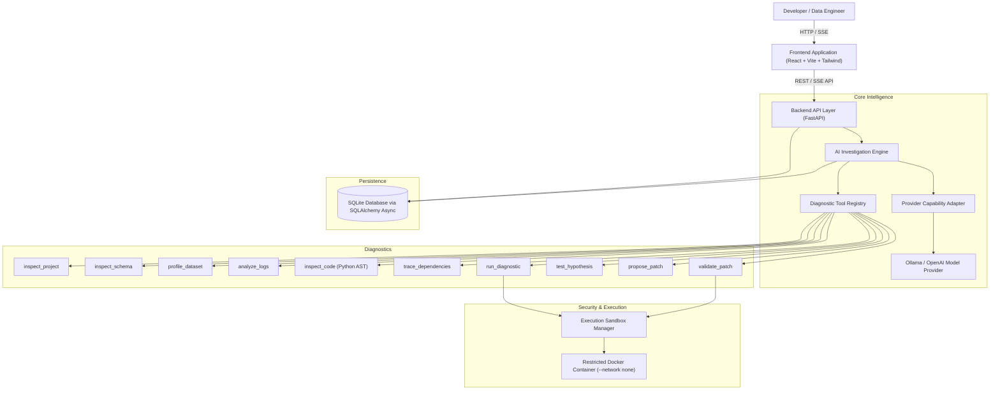
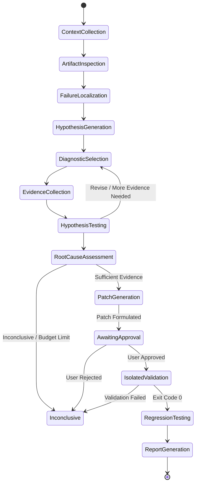

# PipelineSleuth Architecture

PipelineSleuth is an autonomous AI developer infrastructure system that investigates Python data pipeline failures, identifies evidence-backed root causes, formulates syntactically valid code corrections, and validates fixes in isolated sandboxes.

---

## 1. High-Level Subsystems

---

## 2. Investigation State Machine

The investigation loop transitions through explicit stages:

---

## 3. Database Schema

The relational SQLite schema maintains full traceability:
- **`projects`**: Project metadata, pipeline type, candidate entry point.
- **`project_files`**: Ingested files classified as code, data, log, config, or test.
- **`investigations`**: Session objective, current stage, status, confidence score, remaining budget.
- **`investigation_events`**: Chronological log of agent thoughts, stage transitions, tool calls, results.
- **`evidence_records`**: Traceable empirical facts tagged by file, line number, column, and verification status.
- **`hypotheses`**: Hypotheses formulated, status (`formulated`, `testing`, `confirmed`, `rejected`, `inconclusive`), and confidence.
- **`tool_executions`**: Audited diagnostic tool invocations with arguments, results, and execution durations.
- **`patch_proposals`**: Syntactically verified candidate patches with unified diffs and human approval status.
- **`validation_runs`**: Real exit codes, test summaries, stdout, and stderr from candidate executions.
- **`investigation_reports`**: Final synthesized reports ready for Markdown/HTML export.

